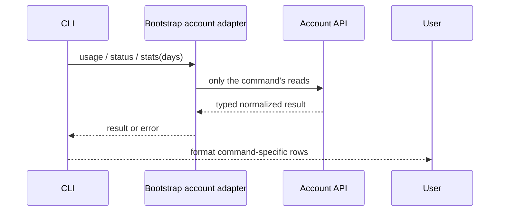

# Standalone Coding Plan commands

The bootstrap account adapter owns remote reads; the CLI command center validates arguments and
formats results. Each invocation reads only the endpoints needed for that command, using the
existing account context and credentials. No command stores an account snapshot.

Successful and empty results start with a descriptive title: `Coding Plan usage`,
`Coding Plan status` and `Coding Plan statistics`.

- `/usage`: current 5-hour, weekly and monthly tool quotas, plus official MCP calls. No subscription,
  available reset inventory or historical totals. Quota errors are reported; MCP remains optional.
- `/status`: subscription name/version, billing cycle, renewal/end date and non-valid status.
  If no subscription entry exists, use the quota plan level. Subscription errors are reported.
- `/stats [days]`: default 7, integer 1–30, including today in local calendar time. Show totals,
  model token totals descending. Do not print time buckets: hourly and empty rows overwhelm
  the summary. Missing history is reported explicitly; errors are surfaced. Never fetch quota, subscription, MCP or resets.
- `/reset [5h|week] [now]`: existing eligibility, inventory, confirmation and spending behavior.

The monitor model-usage contract (also used by the desktop mapper) returns `totalUsage`
(`totalTokensUsage`, `totalModelCallCount`, `modelSummaryList`), with optional top-level
`modelSummaryList`, `x_time`, `tokensUsage`, `modelCallCount`, `granularity` and `modelDataList`.
The CLI uses only total/model summaries and ignores time series. It does not infer per-model
calls, input/output or cache token counts.

Regression coverage: slash parsing/help and dispatch; separated formatter output; endpoint
isolation and credentials; default/custom calendar ranges and invalid periods; summary fallback,
hourly series ignored, titled empty history and API errors. Reset tests continue unchanged.
