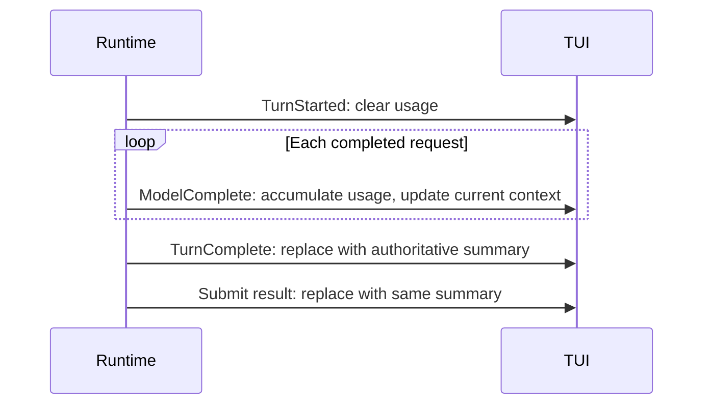

# TUI Sidebar Production Chrome

## Goal

The sidebar should keep production sessions focused on user-facing state while
still leaving rich runtime diagnostics available for development builds.

## Source Of Truth

- The CLI resolves `TuiOptions.developerMode` before launching the TUI.
- `developerMode` is true when the inherited environment has
  `ZCODE_RUNTIME_ENV=development`.
- The TUI treats `developerMode` as display-only input and must not read
  `process.env` directly.
- `TuiOptions.version` carries the CLI version that is already resolved by the
  CLI entrypoint from the root package build metadata.
- `TuiOptions.workspaceDirectory` remains the resolved absolute workspace path.
- The CLI may resolve `TuiOptions.workspaceGitBranch` by running Git from the
  CLI boundary. Git failures, detached HEAD, missing Git, and non-repository
  workspaces are non-fatal and render no branch suffix.

## Layout Contract

- Production sidebar shows status, Context, Turn usage, MCP servers, modified
  files, and todos. Context and Turn usage precede the potentially long lists.
- Developer sidebar additionally shows the OpenTUI shell subtitle, the Run
  section and the API diagnostics section.
- The first sidebar row displays the product name and current CLI version as
  `ZCode <version>`. The `ZCode` segment uses the sidebar accent blue; the
  version segment uses muted text.
- If no version is supplied, the product row falls back to `ZCode 0.0.0` so
  embedded tests and local harnesses have deterministic output.
- The footer never shows stale keyboard hints. It displays the workspace path.
  If a Git branch is available, it appends the branch after a colon, for example
  `/Users/dev/test/z-m:main`.

## Token and Cache Visibility

- Context shows the current window size and latest request's input size, never
  the sum of inputs across requests. Internal tool-model requests contribute to
  turn usage but do not replace the main conversation's current context size.
- Turn usage shows cumulative model calls, input, cached input, output,
  reasoning and input-cache hit rate for the active or latest completed turn.
  Cached input is included in input, not added to it. These are provider token
  counts, not credits or a claim about subscription quota deductions.
- `TurnStarted` clears previous turn usage and cache status. `ModelComplete`
  accumulates each completed request's usage; `TurnComplete` replaces it with
  the runtime's authoritative turn summary (which may include nested calls).
  The final submit result uses the same summary without adding it again.
- Runtime owns usage; TUI only projects events already filtered by session and
  deduplicated by event ID. Errors retain completed-request usage. Session
  replacement clears the projection. Missing usage displays `-`.
- On narrow terminals the existing `Ctrl+X`, then `B` shortcut opens the sidebar.

## MCP Server Section

- The MCP section is a read-only TUI projection. It reads from the app-level
  `listMcpServers()` interface and never imports MCP adapters, starts processes,
  opens network connections, or mutates server state from the component layer.
- The section is visible in production and development sidebars because MCP
  availability changes which tools the agent can use.
- The first row summarizes configured server count and connected server count.
- Each visible server row shows server name, transport, current status, and tool
  count when available. Failed and untrusted servers keep their status visible
  without exposing configured env, header, or secret values.
- MCP status refresh is best-effort and bounded. Refresh failures stay in the
  sidebar as a short status message while the last successful snapshot remains
  visible.
- The MCP section follows the existing sidebar section sizing rules: display-cell
  truncation, fixed row height, and clipping at the bottom when vertical space is
  insufficient.

## Tests

- CLI tests assert `ZCODE_RUNTIME_ENV=development` is projected to
  `TuiOptions.developerMode`.
- CLI tests assert the resolved Git branch is projected to
  `TuiOptions.workspaceGitBranch` without making Git a hard startup dependency.
- TUI sidebar tests assert production mode hides the developer-only sections,
  shows the product/version header, shows MCP status, and shows the workspace
  footer.
- TUI sidebar tests keep developer-mode coverage for provider/model, context, and
  API diagnostic rows.
- Regression coverage checks production token/cache/call visibility, absent
  usage, and two model completions followed by an authoritative turn summary,
  turn errors, and reset on the next turn. Context must remain a request size.
